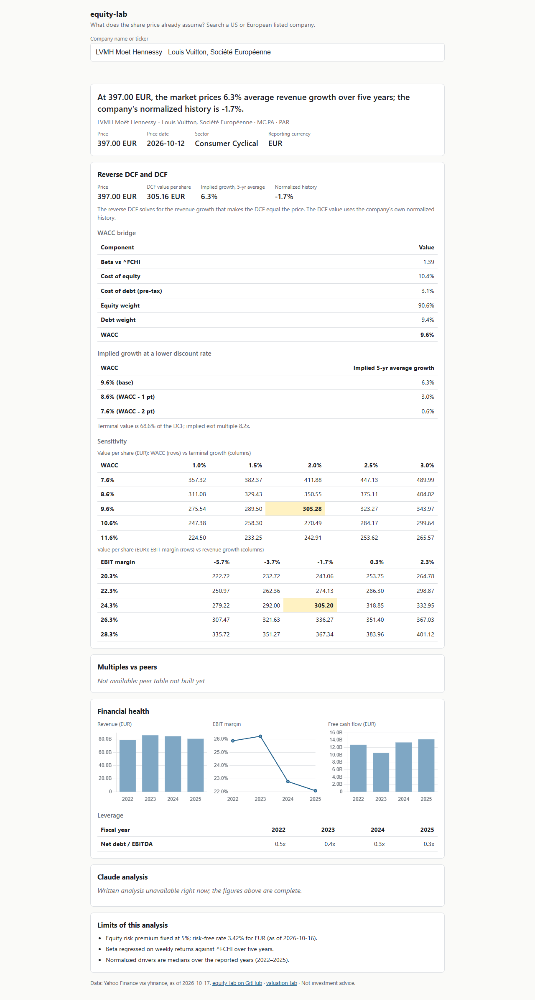

# equity-lab

Type any US or EU company and get an honest equity analysis, reverse-DCF verdict first: what
growth does the current share price already imply, and how does that compare with the company's
own history?


Live: (live link after deployment)



**In short**

- A reverse DCF solves for the five-year average revenue growth that reproduces the share price, and sets it against the company's normalized history. The verdict is a statement about what the market prices, not about whether the price is right.
- Around it: a WACC computed from a re-estimated beta, EV/EBITDA against index peers, and a financial-health block, all on reporting-currency statements with the trading currency kept apart.
- A short narrative written by Claude, checked against the numbers before it is shown, or withheld if it cannot be.

## How it works

- **Engine**: [valuation-lab](https://github.com/emiliensabathier/valuation-lab)'s DCF and reverse-DCF code, fed by `yfinance` statements and weekly prices. Every defaulted or missing input is listed in the page's limits.
- **Peers**: a scheduled job reads index constituents (S&P 500, CAC 40, DAX, FTSE 100, SMI, AEX, IBEX 35, FTSE MIB, OMX Stockholm 30), pulls summary multiples and keeps a parquet table. The page compares EV/EBITDA against the nearest peers by size in the same industry.
- **Server**: FastAPI, one worker, a SQLite cache (analyses for a day, narratives keyed by content), per-IP limits on work that costs something. A daily job pre-generates about fifty well-known names so those pages load instantly.
- **Narrative**: generated by Claude through the author's subscription CLI (`claude -p`, no API key). Every number in the text is checked against the engine's JSON, with tolerance for rounding and units (billions, millions, percent); the wording itself is not checked, beyond a short list of advice words that are refused. A text that fails twice is dropped and the page says the narrative is unavailable.
- **Page**: plain HTML and JavaScript. Every figure comes from the engine's JSON.

## Limitations

- **Data**: `yfinance` is an unofficial wrapper around Yahoo, with no service guarantee. ESEF and EDGAR filings are not used, so line items depend on what Yahoo exposes and some companies are refused for missing core lines.
- **Price** is the last weekly close, not a live quote.
- **Financials and real estate are not covered**: free cash flow to the firm does not describe a bank, an insurer or a property company.
- **Peers** are compared on EV/EBITDA, not EV/EBIT, because the peer figures come from summary data. Peer market caps are in their own listing currencies, so the size ranking is approximate.
- **Mega caps** often imply growth beyond the range the solver can reach; the page then shows a bound, not a point.
- **Narrative** is generated by Claude through the author's subscription CLI, checked against the numbers, and may be unavailable (CLI down, quota, or a text that does not pass the checks).
- The model leans low on cash flows (see valuation-lab's limitations); the implied growth measures the market against this model, not against the truth.
- This is a study tool, not investment advice.

## How to run locally

```bash
python -m venv .venv && source .venv/bin/activate
pip install -e .[dev]
python -m elab build-peers   # slow: one request per constituent, resumable
python -m elab serve         # http://127.0.0.1:8040
```

Data (cache, prices, peer table) goes to `./data`, or to `EQUITY_LAB_DATA` / `--data-dir`. The
narrative needs the `claude` CLI logged in; without it the rest of the page still works.

`python -m elab pregenerate` analyzes the popular tickers listed in `src/elab/config.py`.

## Deploy

Files in [`deploy/`](deploy): a systemd service for the server, a oneshot service and a daily
timer (03:00) running `build-peers` (a failure there does not stop the next step) then
`pregenerate`, and an nginx site. The server and the jobs both run as the `equity-lab` user from
`/opt/equity-lab`, with a `.venv` there and an `.env` file (never committed; see
`deploy/env.example`) holding `CLAUDE_CODE_OAUTH_TOKEN`. Both units are sandboxed: read-only
system, no `/home`, private `/tmp`, writable only under `/opt/equity-lab`.

```bash
sudo useradd -m -d /opt/equity-lab -s /usr/sbin/nologin equity-lab
```

The units set `HOME=/opt/equity-lab` and `PATH=/opt/equity-lab/.local/bin:/usr/local/bin:/usr/bin:/bin`,
so the `claude` CLI must be installed in one of those directories (for example
`/usr/local/bin`). Check it as the service user with the token loaded before enabling the units:

```bash
sudo -u equity-lab env $(cat /opt/equity-lab/.env) claude -p "ok"
```

TLS: the nginx site listens on port 80 only. Set the real `server_name`, then run
`sudo certbot --nginx -d <domain>`. Certbot adds the certificate and `listen 443 ssl` to that
server block, a port-80 redirect, and its renewal timer; the security headers and the `/api/`
rate limit in the block carry over to HTTPS unchanged.

## Tests

```bash
pytest --cov=elab
```

Offline: every fetcher and the Claude runner are injected, fixtures are hand-built, nothing
third-party is committed. CI runs Python 3.11 and 3.12 with an 80% coverage floor.

## Related

- [valuation-lab](https://github.com/emiliensabathier/valuation-lab) — the DCF and reverse-DCF engine behind this site

## License

MIT.
